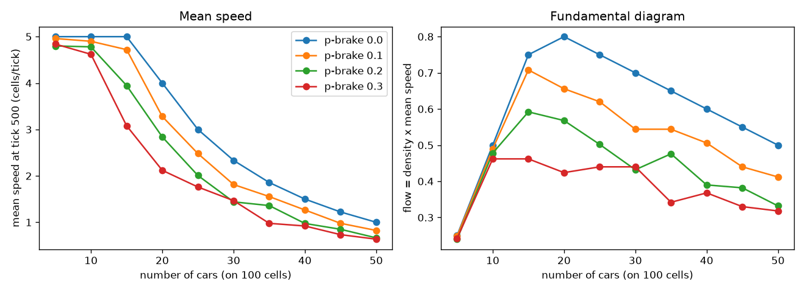

# Lab 1 — A city in motion (NetLogo)

Names:

NetLogo 7.0.4. Every number below was measured. The commands are in `runs/`, their output is in
`measurements.txt`, and the BehaviorSpace table is `experiment.csv`. The runs are seeded
(`random-seed`), so running them again gives the same numbers.

| File | What it is |
| --- | --- |
| `city-in-motion.nlogo` | the model of sections 3 and 4; it opens in NetLogo 7, which saves it again as `.nlogox`. The BehaviorSpace experiment `fundamental-diagram` of section 5.1 is saved inside it |
| `experiment.csv` | BehaviorSpace table output: 10 car counts × 4 values of `p-brake` × 5 repetitions = 200 runs |
| `plot_experiment.py`, `fundamental-diagram.png` | the plots of section 5.1 (run with the project `.venv`: `pandas`, `matplotlib`) |
| `runs/*.txt`, `measurements.txt` | the Command Center commands used for sections 1, 3.5, 4 and 5.3, and their output |

## What I observed in the Models Library

### Wolf Sheep Predation

- **`sheep-wolves`, defaults.** The wolves always die out. In 4 runs out of 5 the sheep die with them: the run
  ends with no animals at all, between tick 164 and tick 226. In the 5th run the wolves die first, and the sheep
  then explode to about 31,000; the model stops at tick 448 ("the sheep have inherited the earth"). Either way
  the story is over within about 150–450 ticks.
- **`sheep-wolves-grass`, both survive:** the default sliders (`wolf-reproduce` 5, `wolf-gain-from-food` 20,
  `sheep-reproduce` 4, `sheep-gain-from-food` 4, `grass-regrowth-time` 30). After 1000 ticks: 48/137,
  77/177 and 60/166 wolves/sheep.
- **`sheep-wolves-grass`, both collapse:** `grass-regrowth-time` 100 and `sheep-gain-from-food` 2, the rest
  default. All 5 runs ended with no animals left, between tick 217 and tick 795. My reading, not checked tick
  by tick: grass grows back too slowly to feed the sheep, and once the sheep are gone the wolves have nothing
  to eat.
  (For contrast, greedy wolves, with `wolf-reproduce` 20 and `wolf-gain-from-food` 50, do *not* make both collapse.
  In all 3 runs the wolves were gone by tick 1000, and about 250 sheep were left, living on the grass.)
- **Does "both survive" always work?** With the default values, yes: 3 out of 3 runs, and 20 out of 20 more runs,
  still had both species at tick 1000. With the slower grass it never worked. Between those two settings there
  is presumably a range where the outcome depends on the random seed. I did not map it.

### Flocking

Watching the view would be the normal way to fill this table. Since I ran the model headless, I measured
it instead. *Alignment* is the length of the mean heading vector: 1 means every bird flies the same
way, about 0 means random headings. *Nearest neighbour* is the mean distance from a bird to its closest
neighbour, in patches. 300 birds, 600 ticks, mean of 5 runs.

| Slider | Rule | What happens when it is 0 |
| --- | --- | --- |
| (none: defaults) | — | alignment 0.98, nearest neighbour 1.05: by tick 600 almost all the birds fly the same way |
| `max-separate-turn` | separation: steer away from a bird that is too close | alignment 0.99, nearest neighbour 0.68: still aligned, but the birds sit much closer together, since nothing keeps them apart |
| `max-align-turn` | alignment: steer towards the average heading of the neighbours | alignment 0.03: no common direction at all; birds are also further apart (2.08) |
| `max-cohere-turn` | cohesion: steer towards the neighbours' average position | alignment 1.00, nearest neighbour 1.77: everyone flies the same way, but the birds are spread further apart: nothing pulls them into groups |

*To check by eye:* these are numbers, not a description of the view. Run each line once in NetLogo and
write what the flocks look like.

**Which rule alone makes birds fly in the same direction?** Alignment. With separation and cohesion
both at 0 and alignment alone, the alignment is still 0.99. Without alignment it falls to 0.03, whatever the
other two do.

### Segregation (density 95 %)

Run until `num-unhappy` reaches 0, or for 200 ticks. Three runs per line.

| `%-similar-wanted` | % similar at the end | ticks needed |
| --- | --- | --- |
| 30 | 74.9 / 73.1 / 76.1 | 20 / 15 / 19 |
| 50 | 85.4 / 85.6 / 86.8 | 31 / 23 / 26 |
| 75 | 95.7 / 91.3 / 87.2 | never settles (7.5 / 15 / 21.8 % still unhappy at tick 200) |
| 80 | 50.1 / 50.8 / 51.1 | never settles (about 95 % unhappy at tick 200) |

At 30 %, everybody would accept being a 70 % minority, and yet the town ends about 75 % similar.

**Above about 75 %** the town stops settling. At 75 % it still sorts itself into very homogeneous blocks
(87–96 % similar), but some households stay unhappy and keep moving. At 80 % it never organises at all.
Almost everyone is unhappy, everybody keeps moving, and % similar stays at 50 %, the random mix. With
only 5 % of the cells empty, an unhappy household almost never finds a place that satisfies such a demanding
rule. Its moves also make its new neighbours unhappy. Asking for more similarity ends with *less* of it.

## Questions

1. **What is emergent in your traffic model?** The phantom jam: a cluster of stopped (red) cars that moves
   *backwards* along the road while every car in it moves forwards. I checked the direction. With 30 cars,
   over 400 ticks, a car stopped at cell *x* at one tick had a stopped car one cell *ahead* (x+1) at the
   previous tick 3698 times, and one cell *behind* (x−1) only 1663 times. The stopped region drifts back
   against the traffic. The model also has a fundamental diagram:
   the flow (density × mean speed) rises with the number of cars, peaks, then falls (see
   `fundamental-diagram.png`). No rule of a single car mentions a jam, a wave moving backwards, or a capacity.
   Each car only looks at the free cells in front of it.

2. **Which of the four rules causes the phantom jams?** Rule 3, the random dawdle. At 10 cars with `p-brake` 0
   every car reaches 5 and stays there forever: mean speed 5.00, no stopped car, in all 20 runs. With `p-brake`
   0.2 and the same 10 cars, random slowdowns appear (mean speed 4.81). At 40 cars there are 17.1 stopped cars
   instead of 7.5. Caveat: at 40 cars, jams exist even with `p-brake` 0, because the road is above its
   critical density. The random start creates queues that never dissolve. So rule 3 *seeds* the jams at low
   density, while at high density the jams are forced by density alone. Rule 3 makes them bigger.

3. **What changes with `p-brake` = 0?** At 10 cars: free flow, every car at `max-speed`, mean speed exactly
   5.00, no jam, ever. At 40 cars: a frozen stop-and-go pattern. Nothing is random any more, so the queues created
   by the random start stay forever. The mean speed is 1.50 in every run, against 1.05 with `p-brake` 0.2,
   with 7.5 stopped cars on average against 17.1.

4. **What does the traffic light cost in mean speed?** The question says to read the monitor at tick 500. That
   is misleading here. The light switches every 30 ticks, so at tick 500 it has been red since tick 480. With
   10 cars, all of them are waiting in the queue, and the monitor reads 0.00. That is a snapshot of the phase,
   not the cost of the light. The mean speed averaged over ticks 1–500, 20 runs each, gives:

   | cars | no light | light | cost |
   | --- | --- | --- | --- |
   | 10 | 4.72 | 2.31 | −51 % |
   | 25 | 2.02 | 1.09 | −46 % |
   | 50 | 0.71 | 0.54 | −24 % |

   (For the record, the monitor at tick 500 reads 4.76 → 0.00, 1.99 → 0.42 and 0.71 → 0.45.)
   The light costs least when the road is already jammed. At 50 cars the cars spend most of their time in
   queues anyway, so the road itself is the bottleneck. A red phase mostly stops cars that would have been slow
   regardless. At 10 cars the road is free, and the light is the only thing that ever stops anyone.

5. **Why do you need repetitions, and how many?** Every run is different: `n-of` places the cars at random,
   and rule 3 draws a random number for every car at every tick. With 30 runs per density (`p-brake` 0.2, mean
   speed at tick 500), the standard deviation *s* and the number of runs needed for *s* / √*n* < 0.05
   are:

   | cars | mean | *s* | runs needed |
   | --- | --- | --- | --- |
   | 10 | 4.74 | 0.175 | 13 |
   | 25 | 2.06 | 0.233 | 22 |
   | 50 | 0.72 | 0.071 | 2 |

   It is not the same number for every density. The runs disagree most near the critical density (20–25
   cars), where one jam more or less changes everything. The 5 repetitions of the BehaviorSpace sweep are
   enough at 50 cars, but not at 25. That is why the 25–40 car points in `fundamental-diagram.png` are bumpy.

## Section 5.1 — the fundamental diagram

Highest flow (mean of 5 runs, read at tick 500):

| `p-brake` | peak flow | at |
| --- | --- | --- |
| 0 | 0.80 | 20 cars |
| 0.1 | 0.71 | 15 cars |
| 0.2 | 0.59 | 15 cars |
| 0.3 | 0.46 | 10 cars |

With `p-brake` 0 the peak is at 20 cars on 100 cells, a density of 0.2, which is close to the theoretical
1 / (`max-speed` + 1) ≈ 0.17. Dawdling lowers the peak and moves it to lower densities. At `p-brake` 0.2 it
costs about a quarter of the road's capacity (0.59 against 0.80).
